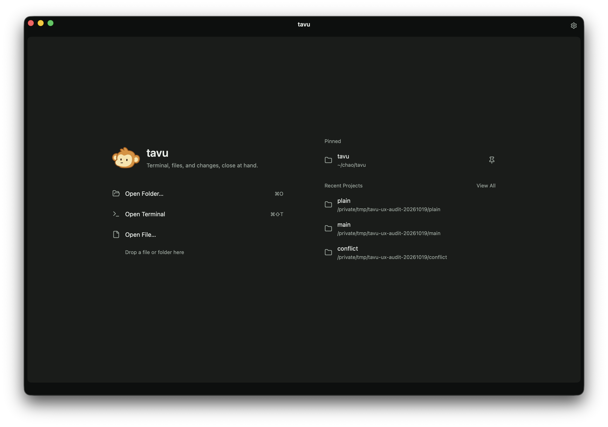
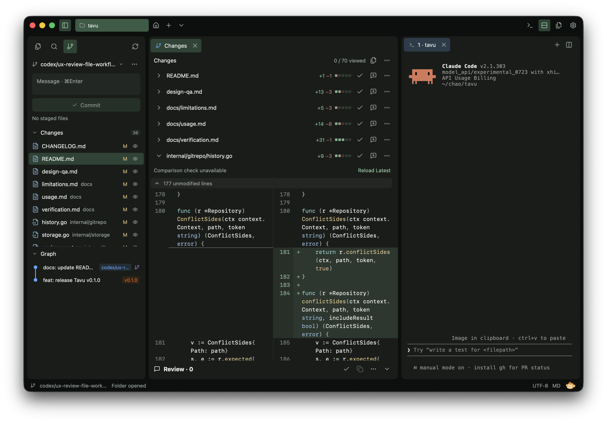

<p align="center">
  
</p>

<h1 align="center">Tavu</h1>

<p align="center">Terminal, files, and changes, close at hand.</p>

<p align="center">
  <a href="#getting-started">Get started</a> ·
  <a href="docs/usage.md">Guide</a> ·
  <a href="CHANGELOG.md">Changelog</a>
</p>



Tavu is a native macOS workspace for running your tools, editing files, and reviewing changes in one place. Written in Go with [MyGo](https://github.com/egoist/mygo).

## Features

- **Projects:** switch between folders while keeping each project's files, drafts, layout, and terminals open.
- **Terminal:** real shells, tabs, split panes, and adjustable fonts, powered by libghostty-vt.
- **Files:** edit and organize files, open them by name, and search with replacement previews.
- **Git:** stage files or hunks, commit, manage branches and stashes, inspect history, and fetch, pull, or push.
- **Review:** browse changes continuously or file by file, leave versioned comments, and paste or drag feedback into a terminal.
- **Appearance:** light, dark, or system themes; English, 简体中文, 繁體中文, and 日本語.

Your files and reviews stay local. Run your preferred CLI tools in the terminal; Tavu has no built-in AI service, account, or telemetry.



## Getting started

Build from source with **Go 1.27.1** and **Git** on an Apple Silicon Mac. The app targets macOS 13+; testing currently covers macOS 26.5.

```sh
git clone https://github.com/ychuo/tavu.git
cd tavu
./scripts/package.sh
open build/darwin-arm64/Tavu.app
```

Start with **Open Folder**, **Open Terminal**, or **Open File**. Builds are locally signed; notarized downloads are not available yet.

## Development

```sh
./scripts/go.sh tool mygo dev  # Run with native dependencies
./scripts/check.sh             # Check, test, and build
```

Use the project scripts to include the native diff-scroll fix. See [development notes](docs/development.md) for packaging and diagnostics.

## Documentation

- [Usage and shortcuts](docs/usage.md)
- [v0.1.1 limitations](docs/limitations.md)
- [UI style](docs/ui-style.md) · [Verification](docs/verification.md)
- [Third-party notices](THIRD_PARTY_NOTICES.md)
